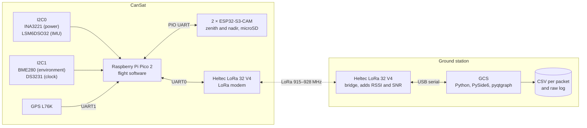

# Proyecto Avutardo

[](https://github.com/tenebrishv/avutardo/actions/workflows/ci.yml)
[](LICENSE)

*[Versión en español](README.md)*

CanSat code of the **UTN Facultad Regional Tierra del Fuego** team at the
**Certamen CanSat Universitario 2026-2027** (Argentine university CanSat
competition), organized by CONAE and ACEMA. This repository holds the flight
software, the radio-link and camera firmware, the ground station and the
telemetry format that ties them together.

> **Status:** the project is at the PDR (Preliminary Design Review) stage. The
> repository has its structure, CI and version 2 of the telemetry format; the code
> for each part is being written from now on. The [Status](#status) table shows
> what exists and what is missing in each folder.

The team works in Spanish: folder READMEs, design notes and code comments are
in Spanish.

## Mission

A 500 g, 90 mm diameter CanSat flies aboard the **Prometeo** rocket, which ejects
it 12 s into the flight, with a maximum apogee of 673 m. From there it descends
on its own recovery system, and throughout the flight it sends telemetry to the
ground station and records video with two cameras, one pointing to the zenith
and one to the nadir. Requirements are cited by their code in Annex A v2 of the
competition (`S1`, `X1`, `G3`…).

## Architecture



- **Pico 2** (no radio): the core. Reads the sensors and the GPS, tracks the
  flight state, drives the cameras and the second-descent servo, and builds the
  complete telemetry packets
  ([ADR 0001](docs/adr/0001-la-pico-arma-el-paquete.md), Spanish).
- **Sensors:** on two I²C buses. On I2C0, the INA3221 (battery, 3.3 V rail
  and solar panel voltage and current) and the LSM6DSO32 (acceleration and
  rotation). On I2C1, the BME280 (pressure, temperature and humidity) and the
  DS3231 clock, which gives the Pico a 1 Hz pulse.
- **GPS:** a separate Seeed Studio L76K, on the Pico's UART1.
- **On-board Heltec:** the CanSat's only transmitter, a LoRa modem and nothing
  else. It transmits the packets from the Pico untouched, on 915–928 MHz
  (`X1`), and forwards to the Pico whatever it receives. Stateless; the Pico
  can reset it.
- **Cameras:** the same program on both; they record to their own microSD when
  the Pico tells them to, over a UART the Pico builds with its PIO blocks, one
  per camera. WiFi and Bluetooth stay off.
- **Power:** a 2S lithium-ion battery (2 × 18500) and a single buck converter,
  which feeds one 3.3 V rail for everything on board. The audio beacon is
  independent, with its own coin cells.
- **Ground Heltec:** a transparent bridge to USB that adds RSSI and SNR to each
  packet. All the logic runs on the laptop.
- **GCS:** decodes, plots in real time, logs every packet and sends the
  telecommands.

The packet format is written once, in
[`protocolo/telemetria.toml`](protocolo/telemetria.toml) and
[`protocolo/telecomandos.toml`](protocolo/telecomandos.toml): the ground
station reads them at startup and, once the flight software exists, a script will
generate the Pico's C header from it.

## Status

| Folder | What it is | Status |
|---|---|---|
| [`gcs/`](gcs/) | Ground station (Python, PySide6 and pyqtgraph) | **Skeleton:** structure, dependencies and CI. It does nothing useful yet. |
| [`protocolo/`](protocolo/) | Telemetry and telecommand format, shared by everything else | **Version 2:** 75-byte binary packet with a CCSDS header and CRC-16, 32 fields grouped by block, each with its English label. Telecommands, **version 1** (#11): 14-byte binary packet with the same header, 19 commands; queries answer through the telemetry's extra pair. `vista_formato.py` (#16) generates the field tables and an example packet in ASCII and binary, as Markdown and CSV, for the PDR. |
| [`firmware/pico/`](firmware/pico/) | Flight software for the Raspberry Pi Pico 2 | No code yet. Its README has the pin assignment. |
| [`firmware/heltec/`](firmware/heltec/) | LoRa link, on board and on the ground | No code yet |
| [`firmware/camaras/`](firmware/camaras/) | ESP32-S3-CAM N16R8 cameras with OV5640 | No code yet |
| [`docs/`](docs/) | Design decisions and their rationale | [Ground station](docs/gcs-decisiones.md) (Spanish) |

Next, in this order: the GCS decoder and mission state, written test-first; the
flight simulator inside the app; and the screen layout, already chosen with a
prototype ([decisions](docs/gcs-decisiones.md), Spanish).

## Running the ground station

You need [uv](https://docs.astral.sh/uv/), which installs the right Python
version and the exact dependencies from `uv.lock`.

```bash
cd gcs
uv sync              # once, or whenever uv.lock changes
uv run avutardo-gcs  # opens the ground station (for now, just a message)
uv run pytest        # tests
uv run ruff check .  # lint
```

## Contributing

- **One issue per topic** and one **short-lived branch** per issue, merged into
  `main` through a pull request.
- Only what passes CI gets into `main`: `ruff check`, `ruff format --check` and
  `pytest`. Run all three before opening the PR.
- Telemetry fields are changed in `protocolo/telemetria.toml`, never in code:
  it is the single source of the format.
- Before proposing a design change, check [`docs/`](docs/) for why things were
  chosen the way they are.
- Since the repository is public, set your GitHub *noreply* email in `git` so
  your own address does not end up in the commits.

## Team

UTN Facultad Regional Tierra del Fuego team, with its faculty advisor.

## License

[MIT](LICENSE).
