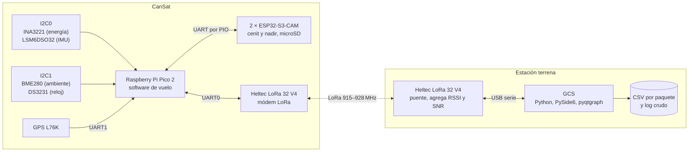

# Proyecto Avutardo

[](https://github.com/tenebrishv/avutardo/actions/workflows/ci.yml)
[](LICENSE)

*[English version](README.en.md)*

Código del CanSat del equipo de la **UTN Facultad Regional Tierra del Fuego** en
el **Certamen CanSat Universitario 2026-2027**, organizado por la CONAE y ACEMA.
Acá viven el software de vuelo, el firmware del enlace de radio y de las
cámaras, la estación terrena y el formato de telemetría que los une.

> **Estado:** el proyecto está en la etapa de la PDR (revisión preliminar de
> diseño). El repo tiene la estructura, el CI y la versión 2 del formato
> de telemetría; el código de cada parte se escribe a partir de ahora. La tabla de
> [Estado](#estado) dice qué hay y qué falta en cada carpeta.

## La misión

Un CanSat de 500 g y 90 mm de diámetro sube a bordo del cohete **Prometeo**, que
lo eyecta a los 12 s de vuelo, con un apogeo máximo de 673 m. Desde ahí baja con
su propio sistema de recuperación, y durante todo el vuelo transmite telemetría
a la estación terrena y graba video con dos cámaras, una al cenit y otra al
nadir. Los requisitos se citan por su código del Anexo A v2 del certamen
(`S1`, `X1`, `G3`…).

## Arquitectura



- **Pico 2** (sin radio): el núcleo. Lee los sensores y el GPS, decide el estado
  del vuelo, maneja las cámaras y el servo del segundo descenso, y arma los
  paquetes de telemetría completos
  ([ADR 0001](docs/adr/0001-la-pico-arma-el-paquete.md)).
- **Sensores:** en dos buses I²C. En el I2C0, el INA3221 (tensión y corriente
  de la batería, de la barra de 3.3 V y del panel solar) y el LSM6DSO32
  (aceleración y rotación). En el I2C1, el BME280 (presión, temperatura y
  humedad) y el reloj DS3231, que le da a la Pico un pulso de 1 Hz.
- **GPS:** un Seeed Studio L76K aparte, en la UART1 de la Pico.
- **Heltec a bordo:** el único transmisor del CanSat, sólo módem LoRa.
  Transmite sin tocarlos los paquetes que le pasa la Pico, en 915–928 MHz
  (`X1`), y le reenvía lo que recibe. No guarda estado; la Pico puede
  reiniciarla.
- **Cámaras:** el mismo programa en las dos; graban en su propia microSD cuando
  la Pico se lo indica, por una UART que la Pico arma con sus PIO, una por
  cámara. El WiFi y el Bluetooth van apagados.
- **Energía:** una batería 2S de ion litio (2 × 18500) y un solo buck, que da
  una barra de 3.3 V para todo lo de a bordo. La baliza sonora es independiente,
  con sus propias pilas.
- **Heltec de tierra:** un puente transparente al USB que le agrega a cada
  paquete el RSSI y el SNR. Toda la lógica está en la notebook.
- **GCS:** decodifica, muestra en tiempo real, guarda cada paquete y manda los
  telecomandos.

El formato de los paquetes está escrito una sola vez, en
[`protocolo/telemetria.toml`](protocolo/telemetria.toml) y
[`protocolo/telecomandos.toml`](protocolo/telecomandos.toml): la estación
terrena los lee al arrancar y, cuando exista la FSW, un script va a generar el encabezado C
de la Pico desde ahí.

## Estado

| Carpeta | Qué es | Estado |
|---|---|---|
| [`gcs/`](gcs/) | Estación terrena (Python, PySide6 y pyqtgraph) | **Esqueleto:** estructura, dependencias y CI. Todavía no hace nada útil. |
| [`protocolo/`](protocolo/) | Formato de telemetría y de telecomandos, compartido por todo lo demás | **Versión 2:** paquete binario de 75 B con cabecera CCSDS y CRC-16, 32 campos agrupados por bloque, cada uno con su etiqueta en inglés. Telecomandos, **versión 1** (#11): 14 B binarios con la misma cabecera, 19 comandos; las consultas responden por el par extra de la telemetría. `vista_formato.py` (#16) genera las tablas de campos y un paquete de ejemplo en ASCII y en binario, en Markdown y CSV, para la PDR. |
| [`firmware/pico/`](firmware/pico/) | Software de vuelo de la Raspberry Pi Pico 2 | Sin código. El README tiene la asignación de pines. |
| [`firmware/heltec/`](firmware/heltec/) | Enlace LoRa, a bordo y en tierra | Sin código |
| [`firmware/camaras/`](firmware/camaras/) | Cámaras ESP32-S3-CAM N16R8 con OV5640 | Sin código |
| [`docs/`](docs/) | Decisiones de diseño y su porqué | [Estación terrena](docs/gcs-decisiones.md) |

Lo próximo, en este orden: el decodificador y el estado de misión de la GCS,
escritos test primero; el simulador de vuelo dentro de la app; y la pantalla,
que ya se eligió con un prototipo ([decisiones](docs/gcs-decisiones.md)).

## Cómo correr la estación terrena

Hace falta [uv](https://docs.astral.sh/uv/), que instala solo la versión de
Python y las dependencias exactas del `uv.lock`.

```bash
cd gcs
uv sync              # una vez, o cuando cambie el uv.lock
uv run avutardo-gcs  # abre la estación terrena (hoy, sólo un mensaje)
uv run pytest        # tests
uv run ruff check .  # lint
```

## Cómo contribuir

- **Un issue por tema** y una **rama corta** por issue, con un PR a `main`.
- A `main` sólo entra lo que pasa el CI: `ruff check`, `ruff format --check` y
  `pytest`. Conviene correr los tres antes de abrir el PR.
- `main` está protegida: no acepta pushes directos ni force pushes, el PR no se
  puede mergear con el CI en rojo, y los merges los hace el responsable del
  repo.
- Un campo de telemetría se cambia en `protocolo/telemetria.toml`, nunca en el
  código: es la única fuente del formato.
- Antes de proponer un cambio de diseño, mirar [`docs/`](docs/): ahí está por
  qué se eligió cada cosa.
- Como el repo es público, configurá en `git` el mail *noreply* de GitHub para
  no publicar el tuyo en los commits.

## Equipo

Equipo de la UTN Facultad Regional Tierra del Fuego, con su docente tutor.

## Licencia

[MIT](LICENSE).
